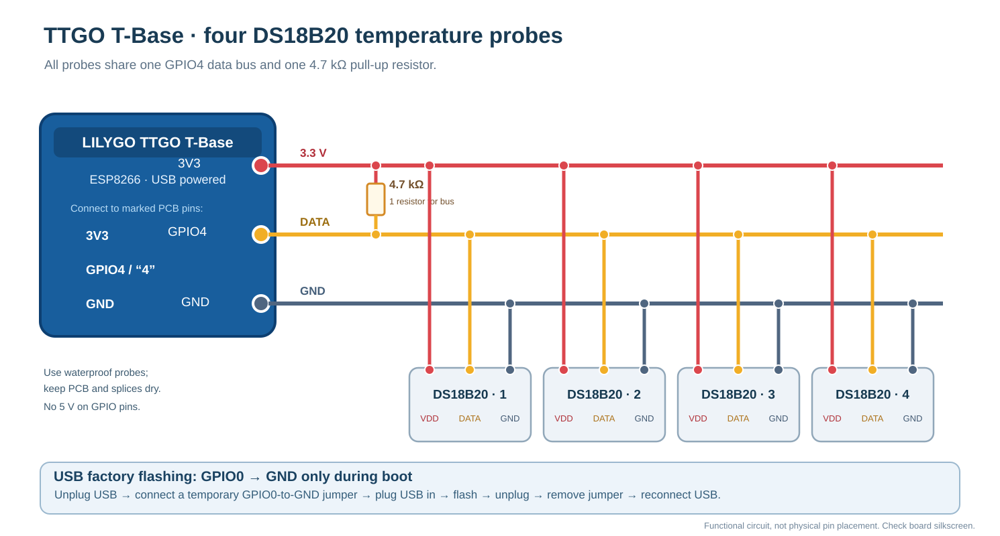
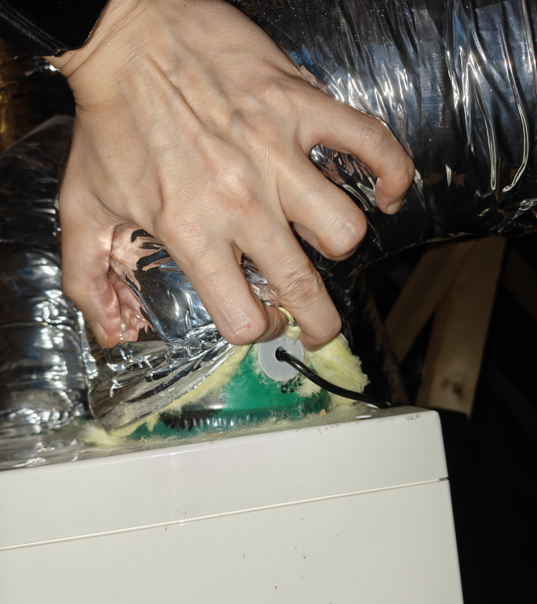
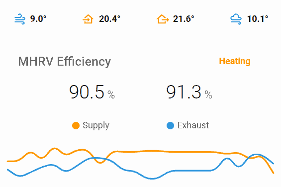

# MHRV Monitor (ESPHome)

Open-source, ESP8266 firmware for a four-probe mechanical heat recovery ventilation (MHRV / MVHR) temperature monitor. Firmware is designed for a Wemos D1 mini-compatible board, four DS18B20 digital sensors, and Home Assistant.

## Features

- Four 12-bit DS18B20 probes on a shared GPIO4 / D2 1-Wire bus.
- **Four named duct temperatures:** Outdoor Air, Supply Air, Extract Air, and Exhaust Air.
- **Four Home Assistant dropdowns** let you assign any of the four physical probes to each duct without editing YAML or reflashing.
- **Read-only device diagnostics:** real flash chip size, full ESP8266 device information, reset reason, free heap / largest contiguous block / fragmentation, main loop time, Wi-Fi RSSI, uptime, IP address and MAC address.
- **Supply Efficiency, Exhaust Efficiency, and Operating Mode** are calculated directly on the ESP8266 using those assigned duct sensors (no Home Assistant template entities needed).
- Configurable polling interval (1–300 seconds; default 5 seconds).
- Four independent per-sensor calibration offsets (±5 °C in 0.05 °C steps).
- Sliding-window moving average (1–20 samples; default 4).
- 0.1 °C quantisation plus user-configurable hysteresis (default 0.02 °C).
- Device settings saved to flash and restored across restarts.
- Encrypted ESPHome native API, with a different key provisioned for every device.
- **Compiled factory firmware**, installable via USB, with no preprogrammed user credentials.
- **Published HTTP OTA binaries and firmware manifest** with a Home Assistant update entity that checks for updates every 6 hours.
- Browser-based USB installation via ESP Web Tools (after enabling GitHub Pages).

**Important security limitation:** This design uses ESP8266 with ESPHome HTTP OTA. Its HTTP client cannot verify TLS server certificates, and the downloaded firmware is only checked against the MD5 provided in the same manifest. A network attacker able to replace both the firmware and manifest could install malicious firmware. This is **not an authenticated update channel**. Only deploy on networks where you accept this risk; prefer an ESP32 with supported signed OTA verification for a security-sensitive product.

## Hardware and wiring

The **LILYGO TTGO T-Base (ESP8266)** is the hardware used for this project. It has **4 MB flash**, a Micro-USB port, and a D1 mini-compatible ESP8266 pin layout. Other D1 mini-compatible ESP8266 boards can use the same firmware if wired to the correct GPIO and powered appropriately.

**Reference MVHR unit:** This project was installed and tested on a **Vent-Axia Kinetic Advance S**. The duct sensor mounting photos and installation notes show this setup. The temperature-monitoring firmware is not specific to this ventilation model; check other units' duct layouts and manufacturer instructions before fitting sensors.

### Power the TTGO T-Base

The **LILYGO TTGO T-Base (ESP8266)** can be powered using its Micro-USB port or a suitable external low-voltage supply connected to the corresponding power pins:

| Power source | Board connection | Notes |
| --- | --- | --- |
| USB power | Micro-USB connector | Convenient for initial flashing and testing |
| **Regulated 5 V DC** | **`5V` and `GND`** | Uses the board's onboard 3.3 V regulation |
| **Regulated 3.3 V DC** | **`3V3` and `GND`** | Supplies the 3.3 V rail directly; **must not exceed 3.3 V** |

**My installation:** For the **Vent-Axia Kinetic Advance S**, I powered the TTGO T-Base from a **5 V connection on the ventilation unit's main circuit board**: 5 V to the TTGO **`5V` pin**, and the corresponding ground to **`GND`**. This avoids needing a separate USB power supply.

**Optional power-supply decoupling:** In my installation I also fitted **two 10 µF ceramic capacitors**, each connected **across a power rail and ground**:

- One **10 µF** capacitor between **`5V` and `GND`**.
- One **10 µF** capacitor between **`3V3` and `GND`**.

Both capacitors are connected **in parallel with the respective supply rails**, not in series with the power wires. They can help smooth short supply-voltage fluctuations when the ESP8266 Wi-Fi radio draws current, but **they are optional** and do not replace a stable, adequately rated power source. Use non-polarised ceramic capacitors with a suitable voltage rating (preferably **10 V or higher** for the 5 V rail), place them close to the board's power pins, and avoid shorting adjacent terminals.

**Important electrical precautions:**

- **Do not assume that any terminal labelled 5 V on an MVHR board is a general-purpose power supply.** Confirm the correct terminal, polarity, regulated output voltage and **available continuous/startup current** using the specific unit's documentation and/or a qualified technician before connecting anything. A signal or LED output may be unsuitable for powering an ESP8266; the Vent-Axia documentation describes a **5 V LED indication output**, not a guaranteed auxiliary supply for third-party electronics.
- **Isolate the ventilation unit from mains power before opening its electrical compartment or connecting wires.** Mains voltage is present in the equipment. If you are not qualified to work inside the unit, use an independent certified 5 V USB adapter instead.
- Use a stable power supply with sufficient headroom for **ESP8266 Wi-Fi current peaks** and the connected probes. Protect and secure the wires, maintain separation from mains wiring, and avoid exposed conductors or shorts.
- **Never connect 5 V to `3V3`, `GPIO4`, or any other ESP8266 GPIO.** The DS18B20 sensors in the wiring diagram are still supplied from the **3V3** rail even when the TTGO itself is powered from 5 V.
- Avoid connecting external power and USB power **at the same time** unless you have confirmed the board's power-path/backfeed protection supports it. Disconnect the external supply when programming over USB.

This describes how my unit is powered, **not a manufacturer-approved modification** or a guarantee that every Vent-Axia control-board revision provides an appropriate 5 V supply.

### Connect four DS18B20 temperature probes



All **four probes are wired in parallel**, using the same three board pins:

| DS18B20 wire / terminal | TTGO T-Base pin | Purpose |
| --- | --- | --- |
| **VDD** (usually red) | **3V3** | 3.3 V supply |
| **DATA / DQ** (often yellow or white) | **GPIO4** (pad marked **4**, equivalent to D2 on a Wemos D1 mini) | Shared 1-Wire data bus |
| **GND** (usually black) | **GND** | Common ground |

Connect **one 4.7 kΩ resistor between 3V3 and GPIO4/DATA**, shared by all four sensors. Do not fit a separate pull-up resistor for every probe. The firmware's `one_wire` bus is configured as `pin: GPIO4` in `mhrv-monitor.yaml`.

**Important:** Probe wire colours are not guaranteed: verify the pin assignment in the sensor seller's documentation before connecting power. Use **3.3 V**, not 5 V, for the sensors in this wiring arrangement, and never connect 5 V directly to an ESP8266 GPIO. Only immerse properly sealed waterproof probe tips in water; keep PCB, connectors, and joints dry. Insulate exposed wiring and check for shorts before powering the board.

> The TTGO T-Base board's I²C-labelled connectors can differ from conventional ESP8266 SDA/SCL naming; use the actual **GPIO4** pad (marked `4`) for this project rather than guessing based on an I²C label. <a href="https://www.tinytronics.nl/en/lilygo-ttgo-t-base-esp8266">Board reference</a>

### Install the temperature probes in the MVHR ducting

**Installation precautions:** Ductwork varies by manufacturer. Before drilling, check the MVHR manufacturer's servicing and warranty requirements, verify the exact duct location, and make sure the sensor/adapter will not obstruct airflow or interfere with dampers, fans or cleaning access. Remove all swarf and debris. This is a documented example of a user installation, **not a manufacturer-approved procedure, do on your own risk only**.

The four DS18B20 probes should measure air temperature **inside the four ventilation ducts**, close to the MVHR/MHRV unit. The installation shown below uses a **custom 3D-printed sensor adapter** to hold each waterproof probe in the duct wall.



**3D-printable adapter:** [Download the STL model](docs/models/MHRV_sensor_adapter.stl) — designed for this installation. **Print four adapters**, one per temperature probe. Check that the model fits your own probe and duct before making holes.

**Material:** The example adapters were printed in **ASA**. **ABS** and **PETG** are also possible, subject to the temperatures at your installation. **Avoid PLA**, which can soften or deform in warmer duct environments. The adapter has a thin section and can break if forced; handle it carefully.

#### Fitting the adapters

1. **Choose the installation points.** Identify the outdoor, supply, extract and exhaust ducts. Select a suitable place on **each duct a few centimetres above the ventilation unit casing**, as in the photo. Check that the sensor will be in the moving airstream and that the location is clear of internal parts, wiring and any obstruction. Avoid drilling into the MVHR unit itself.
2. **Switch the ventilation unit off and isolate its electrical supply** before drilling or reaching into the ducting. Peel back just enough of the foil-faced insulation to access the actual duct wall. Take care not to damage wiring or other components, and keep drilling debris out of the system.
3. **Make a small pilot/fitting hole.** The adapter's insertion section is approximately **9 mm** across. In this installation, an **8 mm drill bit** was used first, then the opening was gradually enlarged with a **round file** until the adapter could be pushed into place with a snug fit. A **9 mm** drill may also work depending on the printed tolerances.
4. **Test the fit before enlarging further.** A **10 mm drill bit** is an option, but the opening can become too wide and leave the adapter loose. If unsure, drill a test hole in a piece of scrap material first. You can always enlarge a small hole; you cannot easily make an oversized hole smaller.
5. **Glue the empty adapter into the duct first.** Apply a small bead of suitable adhesive/sealant around the adapter's base/flange and gently press the **adapter without a sensor** into the prepared hole. Seal around the adapter's base so the joint between the adapter and duct is airtight. Select an adhesive compatible with the duct material, printed plastic and expected operating temperature.
6. **Wait for the adhesive to cure, then insert the sensor.** Only after the glue has completely dried and the adapter is securely fixed in place, gently push the waterproof sensor through the adapter until the **entire metal sensing sleeve protrudes beyond its inner end into the airstream**. From the outer side, **only the bare cable should be visible**. The sensor should fit tightly and form its **own airtight seal inside the adapter**: **do not apply glue or sealant to the sensor or its cable**. Do not use excessive force, as the printed adapter may crack.
7. **Restore the insulation and check operation.** Carefully reseal the foil/vapour barrier around the cable and adapter so the duct stays insulated. Repeat for all **four** ducts, reconnect the probes to the common GPIO4 bus, restore power, and confirm all four temperature readings are available. Finally assign each physical probe to **Outdoor Air**, **Supply Air**, **Extract Air** and **Exhaust Air** in Home Assistant.

**Installation order:** Fit and glue each **empty adapter** into the duct, allow the adhesive to cure fully, and **only then insert its temperature sensor**. The probe itself is a removable press-fit and must not be glued.

### Enter USB flashing mode (TTGO T-Base)

On this TTGO T-Base, you can manually enter the ESP8266 serial bootloader with a temporary connection between **GPIO0 (pad `0`)** and **GND** **while power is first applied**. This is **not the same pin as GPIO4**, which is used for the temperature probes.

1. **Unplug USB / disconnect power.** Do not install or move jumpers with the board powered.
2. Temporarily connect **GPIO0 (`0`) → GND** using a jumper wire.
3. **While the jumper is connected**, plug the Micro-USB cable into the computer. The chip should enter serial download / flashing mode.
4. Open the [browser firmware installer](https://stepyon.github.io/MHRV-monitor-esphome/) in Chrome or Edge, choose the device's serial port, and flash the **factory firmware**. Some USB adapters or flashing tools can enter this mode automatically, so the jumper may not always be necessary.
5. When flashing is finished, **unplug USB again**, remove the GPIO0-to-GND jumper, then reconnect USB. The device should now start normally and expose its setup hotspot for initial provisioning.

**Never leave GPIO0 permanently shorted to GND**, or the ESP8266 will continue to enter its bootloader instead of running the firmware after power-up. Avoid accidentally shorting GPIO4 or 3V3 to GND. This manual procedure follows [Espressif's ESP8266 boot-mode documentation](https://docs.espressif.com/projects/esptool/en/latest/esp8266/advanced-topics/boot-mode-selection.html). **Subsequent Home Assistant OTA updates do not need a jumper or a USB cable.**

Place your DS18B20 probes in the four ducts. The physical probes appear as the existing **Temperature 1–4** measurements (also referred to as **Probe 1–4** in the mapping dropdowns), and four additional sensors expose stable duct-oriented names:

| Named temperature | Airflow measurement |
| --- | --- |
| **Outdoor Air** | Outside air entering the ventilation unit |
| **Supply Air** | Treated air delivered from the unit to the rooms |
| **Extract Air** | Air returning from rooms into the ventilation unit |
| **Exhaust Air** | Air discharged from the unit back outdoors |

**Important:** Probe numbers follow the DS18B20 hardware-address index (0–3), **not physical duct position or wiring order**. Index assignments can change if a sensor is added, removed, or replaced. The four dropdowns let the user assign mapping without reflashing. The mapping choices themselves persist across restarts and normal OTA updates, but aren't a guarantee that the physical probe indexes remain unchanged after hardware replacements.

## Install the compiled factory image

1. Open **[MHRV Monitor firmware installer](https://stepyon.github.io/MHRV-monitor-esphome/)**, after the first release is published and GitHub Pages is enabled. Use a desktop Chrome or Edge browser with Web Serial and connect the ESP8266 via USB.
2. If your TTGO T-Base doesn't enter flashing mode automatically, first follow [Enter USB flashing mode](#enter-usb-flashing-mode-ttgo-t-base): unplug USB, temporarily connect GPIO0 to GND, reconnect USB, then flash. After flashing, unplug USB and **remove the jumper** before powering the board normally. Select **Install** to flash the factory firmware. Alternatively download `mhrv-monitor-vX.Y.Z-firmware.factory.bin` from [GitHub Releases](https://github.com/Stepyon/MHRV-monitor-esphome/releases) and flash via a compatible serial flashing tool at offset `0x0`.
3. Configure Wi-Fi via the USB **Improv Serial** setup, or join the device's initially open **MHRV Monitor Setup** Wi-Fi hotspot and visit `http://192.168.4.1` to enter your home Wi-Fi credentials. The open provisioning AP is for first-time setup; avoid doing this on an untrusted network.
4. Add the new device to **Settings → Devices & services → ESPHome** in Home Assistant. Its name contains a MAC suffix for uniqueness. Complete the **per-device encryption key provisioning** when prompted. Use a current Home Assistant version that supports provisioning.
5. The device exposes **four physical temperature channels (Temperature 1–4)**, **four named duct temperatures**, **two efficiency measurements**, **one operating-mode text sensor**, four probe-mapping dropdowns, seven numeric configuration controls, and an **MHRV Monitor Firmware** update entity. Adjust mapping, offsets and filtering in Home Assistant.

### Assign the probes in Home Assistant

On the ESPHome device page, find the four dropdowns:

| Mapping control | Initial default (placeholder) |
| --- | --- |
| Outdoor Air Probe | Unassigned |
| Supply Air Probe | Unassigned |
| Extract Air Probe | Unassigned |
| Exhaust Air Probe | Unassigned |

**The four mappings default to Unassigned, so no duct is accidentally given the wrong probe.** To identify each probe, temporarily warm or cool the probe tip before placing it in its final location and watch which **Temperature 1–4** reading changes. Then choose that numbered probe for the appropriate duct. The named temperature sensors update as soon as the mapping is changed (provided a reading is available), and maintain stable Home Assistant entity IDs even when mappings change.

Mappings are saved in ESP8266 flash through `restore_value: true`. The physical sensor calibration and smoothing still apply **before** any duct mapping. For example, changing the Supply Air dropdown to Probe 4 displays **Temperature 4**, including its individual calibration offset and configured smoothing.

Until a role has been assigned, its named temperature is unknown. For simplicity, the dropdowns don't prevent choosing the same probe for multiple ducts. For correct ventilation monitoring, **assign each probe to exactly one duct**. If hardware sensors are replaced, check the mapping again because index numbering can change.

### Calibrate the temperature probes (important for efficiency calculations)

**Calibrate all four probes against each other before installing them in different ducts.** The supply and exhaust efficiencies are calculated from **differences between measured temperatures**. Small disagreements between probes can therefore produce misleading efficiency values, especially when the outdoor and extract temperatures are close.

A simple **common water-bath calibration** works well for matching the probes:

1. Connect all four waterproof DS18B20 probes to the board and confirm **Temperature 1–4** update in Home Assistant. Leave the electronics and any unsealed connections **outside** the water.
2. Fill a glass or container with room-temperature water. Place all four **sealed metal probe tips in the same water**, at approximately the same depth, without touching the sides or bottom of the glass. Stir gently to make the temperature uniform.
3. **Wait roughly 30 minutes**, or until all four readings stop drifting. Avoid touching the probes or warming the glass with your hands during the measurement.
4. Note the four **Temperature 1–4** values in Home Assistant. Pick a common target temperature. For *relative* matching, using the median or average of stable probe readings is fine; for absolute accuracy use a reliable calibrated reference thermometer.
5. For each probe, adjust its matching **Temperature N Calibration** number in Home Assistant. Use:
   `new offset = current offset + (target temperature − current displayed temperature)`
   The controls support **0.05 °C** steps.
6. Allow the readings to stabilise again after each adjustment. Repeat if necessary until all four agree as closely as practical (typically within **0.1 °C**, the firmware's published resolution).
7. Remove the probes, dry them, install them in the four ducts, and use the **Outdoor Air / Supply Air / Extract Air / Exhaust Air Probe** dropdowns to assign their physical locations.

**Worked example:** Suppose the four stable displayed temperatures in the same water bath are 21.2 °C, 21.5 °C, 21.1 °C and 21.4 °C. To match **21.3 °C** with initial zero offsets, enter:

| Physical probe | Reading before | Calibration offset | Expected reading |
| --- | ---: | ---: | ---: |
| Temperature 1 | 21.2 °C | +0.10 °C | 21.3 °C |
| Temperature 2 | 21.5 °C | −0.20 °C | 21.3 °C |
| Temperature 3 | 21.1 °C | +0.20 °C | 21.3 °C |
| Temperature 4 | 21.4 °C | −0.10 °C | 21.3 °C |

The example offsets are **not universal**: use your own measured readings. The firmware stores each offset in flash and applies it **before** assigning the probe to an airflow role or computing efficiency. You normally only need to repeat this if you replace a probe or see its readings drift.

**What this method can and cannot do:** Matching probes in one water bath removes much of their relative offset error at that temperature, which is especially useful for the efficiency calculations. It does **not** certify absolute accuracy over the entire temperature range or correct differences in sensor response time. A two-temperature comparison against a calibrated reference is preferable if you need precise absolute measurements.

The same compiled binary works for every new supported board: Wi-Fi credentials and the API encryption key are provisioned and stored in device flash, **not inside the public image**. ESPHome limits the initial provisioning window to five minutes; power-cycle the device if the setup window expires.

## One-click OTA from Home Assistant

After a release is published, the device reads a version manifest from:

`https://stepyon.github.io/MHRV-monitor-esphome/firmware/manifest.json`

The `update.http_request` component checks periodically and exposes an update entity in Home Assistant. If the published version is newer, Home Assistant can present a firmware update with an **Install** action. The ESP8266 downloads the matching `firmware.ota.bin` from GitHub Pages and flashes it, then reboots. It uses the OTA image, **not** the USB factory image.

Release versions are embedded in the firmware's `esphome.project.version`; both the image and the manifest are generated from the same `vX.Y.Z` tag. This is a **manual one-click update** model; updates are not silently installed. Keeping the flash partition and firmware format compatible matters across updates.

**Caveats:** ESP8266 HTTP OTA is vulnerable to network man-in-the-middle attacks because `verify_ssl: false` is required. A public MD5 checksum detects accidental corruption but does not authenticate a release. ESPHome also has a reported [ESP8266 HTTP OTA issue where stored Wi-Fi credentials can be lost](https://github.com/esphome/esphome/issues/16211), observed on certain 1 MB configurations. Use a D1 mini with 4 MB flash; **physically test whether Wi-Fi credentials, encryption keys and calibration settings survive an HTTP OTA on your chosen board before distributing it**. No compatibility test on hardware is implied by a successful CI compilation.

If an update fails, recovery may require USB serial flashing or re-provisioning Wi-Fi. For high-security deployments switch to ESP32 and a signed-OTA design.

### Local firmware customization

The universal factory firmware intentionally has **no native ESPHome OTA endpoint**. A runtime-provisioned API key cannot be inherited as a native OTA encryption key at build time, and enabling unauthenticated native OTA would expose all devices on the local network. Developers can instead USB-flash a custom image or add native encrypted OTA when building a personalized YAML with a known per-device key. Such builds are outside the common managed release channel.

## Releases and continuous integration

- Pull requests and pushes to `main`: GitHub Actions installs pinned **ESPHome 2026.11.0**, validates the no-secret YAML, compiles, and checks that both factory and OTA images are present.
- Push a tag like `v0.1.0` **after merging to main**: the release workflow compiles with `-s firmware_version 0.1.0`, runs `scripts/package_release.py`, creates a GitHub Release with both images, source archive and SHA256 checksums, and deploys a versioned OTA image plus latest update manifest to GitHub Pages.
- GitHub Pages must be enabled under **Settings → Pages → Build and deployment → Source: GitHub Actions** before the firmware feed works. The deployment workflow attempts to enable Pages but repository settings may still require manual intervention.
- Check the [Actions page](https://github.com/Stepyon/MHRV-monitor-esphome/actions) and published [GitHub Pages firmware manifest](https://stepyon.github.io/MHRV-monitor-esphome/firmware/manifest.json) before advertising a release. A merged PR alone does **not** publish a release or enable OTA notifications.

Release files include:
- `mhrv-monitor-vX.Y.Z-firmware.factory.bin` — serial first-install image.
- `mhrv-monitor-vX.Y.Z-firmware.ota.bin` — HTTP OTA update image.
- `mhrv-monitor-vX.Y.Z-source.tar.gz` — source files.
- `SHA256SUMS.txt` — independently checkable hashes.
- GitHub Pages `firmware/manifest.json` and `firmware/manifest.web.json` — latest-update and browser-installer manifests.

**Release maintenance:** Use an increasing version number, do not retag published versions, verify the release on the exact target ESP8266 board, and retain offline copies of older images for recovery. The public release feed follows the latest deployed tag; prerelease tags would also be published to the stable feed, so only tag versions you intend to offer everyone.

### Publishing a new firmware version

The source version defaults to `0.1.0` for local development; the tagged release workflow overrides it with `-s firmware_version X.Y.Z`. **After merging new changes, create a new version tag** (e.g. `v0.2.0`), rather than changing or retagging `v0.1.0`. Devices running `v0.1.0` will then see the newer release in Home Assistant once the GitHub Pages deployment succeeds.

## Filters, controls, and hardware identity

Each physical DS18B20 sensor receives an independent `.temperature_filters.yaml` lambda instance and history. The filter averages the most recent raw readings over the configured window, applies the sensor-specific calibration, rounds to 0.1 °C and publishes only when the midpoint plus hysteresis is crossed. Filtering does not retroactively reprocess previous samples after a control change.

The four named temperature entities are virtual template sensors driven by **Temperature 1–4** readings. When a physical probe publishes a new filtered temperature, all four mapped entities update, followed by the efficiencies and operating mode. Changing a dropdown immediately recomputes every named and derived value, without a reboot or firmware rebuild. An unassigned or missing probe yields an unknown temperature, rather than leaving a stale reading. Mappings don't change the measured data on the physical probes.

### Thermal recovery calculations (device-side)

All three values use the **named, mapped air-temperature entities**, not hardcoded physical sensor indexes. Their values therefore follow the user-configured mapping automatically.

- `Outdoor Air` (**O**): outside fresh air entering the MVHR unit.
- `Supply Air` (**S**): conditioned air supplied to rooms.
- `Extract Air` (**I**): indoor air returning to the exchanger.
- `Exhaust Air` (**E**): air discharged outdoors after the exchanger.

**Supply Efficiency (%)** is `clamp(100 × (S − O) / (I − O), 0, 100)`.

**Exhaust Efficiency (%)** is `clamp(100 × (I − E) / (I − O), 0, 100)`.

Both efficiencies are rounded to one decimal place. If the absolute indoor/outdoor temperature difference `|I − O|` is **1 °C or less**, they report `0%`, matching the previous Home Assistant templates. If any required mapped temperature is unavailable, the efficiency measurement is unavailable rather than reporting a misleading zero.

**Operating Mode** is computed using all four temperatures:

| Condition (evaluated in order) | Reported mode |
| --- | --- |
| A required duct temperature is missing or unassigned | Unknown |
| `|I − O| < 3°C` | Neutral |
| `100 × |S − O| / |I − O| < 30` **and** `100 × |I − E| / |I − O| < 30` | Bypass |
| `O < I` | Heating |
| Otherwise | Cooling |

The operating-mode calculation corrects a typo in the previous Home Assistant configuration: it uses **Exhaust Air**, rather than mistakenly reusing **Extract Air** in the exhaust-side transfer calculation.

These are temperature-based *estimates* of heat-recovery effectiveness and operating behaviour, not direct measurements of fan state, damper position or official MVHR efficiency. Sensor placement, calibration, and airflow balance can affect the result.

## Example Home Assistant dashboard

This compact Lovelace card displays the **four duct temperatures** across the top, followed by the **Supply and Exhaust efficiencies** and their last **24 hours of history**. The operating-mode badge displays **Heating**, **Cooling**, **Neutral**, or **Summer Bypass** (when the device reports `Bypass`).



To use this example, install these three custom Home Assistant cards (available through [HACS](https://www.hacs.xyz/)):

- [Mushroom Cards](https://github.com/piitaya/lovelace-mushroom) for the temperature chips.
- [Mini Graph Card](https://github.com/kalkih/mini-graph-card) for the dual efficiency history graph.
- [card-mod](https://github.com/thomasloven/lovelace-card-mod) for the coloured operating-mode badge.

In a Home Assistant dashboard, choose **Edit dashboard → Add card → Manual**, then paste the YAML below. You can also copy the standalone file: **[examples/mhrv-efficiency-dashboard.yaml](examples/mhrv-efficiency-dashboard.yaml)**.

**Adjust the entity IDs** to match your installation. The example uses `sensor.mhrv_monitor_...`; automatically discovered names may include a MAC suffix (such as `_4a3f89`) or your own renamed device prefix. The badge is positioned using the mini-graph card's CSS, so you may need to adjust the `top` or `left` values for your theme and screen size.

```yaml
cards:
  - alignment: justify
    chips:
      - content: >
          {{ '%.1f' | format(states('sensor.mhrv_monitor_outdoor_air') | float)
          }}°
        entity: sensor.mhrv_monitor_outdoor_air
        icon: mdi:weather-windy
        icon_color: blue
        tap_action:
          action: more-info
        type: template
      - content: >
          {{ '%.1f' | format(states('sensor.mhrv_monitor_supply_air') | float)
          }}°
        entity: sensor.mhrv_monitor_supply_air
        icon: mdi:home-import-outline
        icon_color: orange
        tap_action:
          action: more-info
        type: template
      - content: >
          {{ '%.1f' | format(states('sensor.mhrv_monitor_extract_air') | float)
          }}°
        entity: sensor.mhrv_monitor_extract_air
        icon: mdi:home-export-outline
        icon_color: orange
        tap_action:
          action: more-info
        type: template
      - content: >
          {{ '%.1f' | format(states('sensor.mhrv_monitor_exhaust_air') | float)
          }}°
        entity: sensor.mhrv_monitor_exhaust_air
        icon: mdi:weather-windy-variant
        icon_color: blue
        tap_action:
          action: more-info
        type: template
    type: custom:mushroom-chips-card
  - aggregate_func: avg
    align_state: center
    card_mod:
      style: |
        .graph__container::after {
          content: "{{ 'Summer Bypass' if is_state('sensor.mhrv_monitor_operating_mode', 'Bypass') else states('sensor.mhrv_monitor_operating_mode') }}";
          position: absolute;
          left: 85%;
          top: -120px;
          transform: translateX(-50%);
          z-index: 20;

          padding: 3px 10px;
          border-radius: 12px;

          font-size: 12px;
          font-weight: 600;
          line-height: 18px;

          color:
            
              var(--orange-color, #ff9800)
            
              var(--blue-color, #2196f3)
            
              var(--green-color, #4caf50)
            
              var(--secondary-text-color)
            ;

          background: var(--ha-card-background, var(--card-background-color));
          box-shadow: 0 1px 4px rgba(0, 0, 0, 0.15);
          pointer-events: none;
        }
    decimals: 1
    entities:
      - entity: sensor.mhrv_monitor_supply_efficiency
        name: Supply
        show_state: true
      - entity: sensor.mhrv_monitor_exhaust_efficiency
        name: Exhaust
        show_state: true
    font_size: 75
    height: 75
    hours_to_show: 24
    line_width: 3
    name: MHRV Efficiency
    points_per_hour: 12
    show:
      fill: false
      icon: false
      labels: false
      legend: true
      name: true
      points: false
    smoothing: true
    type: custom:mini-graph-card
type: vertical-stack
```

## ESP8266 OTA diagnostics and troubleshooting

The diagnostic entities below are exposed through the **ESPHome device page** in Home Assistant. Most have `entity_category: diagnostic` and may appear under Diagnostics rather than the main sensor group.

| Entity | Purpose |
| --- | --- |
| **Flash Chip Size** | Actual SPI flash capacity reported by `ESP.getFlashChipRealSize()`, in MB (for TTGO T-Base, expect around 4 MB) |
| **Device Information** | ESPHome version, flash chip size/speed/mode and ESP8266 chip/flash information |
| **Reset Reason** | ESP8266's last reset reason, useful to distinguish OTA software restarts from crashes |
| **Free Heap / Largest Free Heap Block / Heap Fragmentation** | RAM and fragmentation for identifying OTA failures or memory pressure |
| **Main Loop Time** | Main event-loop latency |
| **WiFi Signal** | Wi-Fi signal strength in dBm |
| **Uptime** | Seconds since last boot, useful for spotting spontaneous restarts |
| **IP Address / MAC Address** | Network identification while diagnosing reconnect or mDNS problems |

All added diagnostics are **read-only**. No new `restore_value` controls are introduced, to avoid shifting the order of ESP8266 persisted preferences; the four existing probe mapping selects and all seven existing numeric settings remain in their original order.

## Entity naming in Home Assistant

The firmware keeps `esphome.name_add_mac_suffix: true` so that every ESP8266 flashed from the **same public factory image** has a unique hostname for mDNS and Home Assistant discovery. On some Home Assistant versions, that suffix is incorporated into the **generated entity IDs**.

For example, an existing entity may be named `sensor.attic_mhrv_monitor_4a3f89_exhaust_air`. You can rename it to `sensor.attic_mhrv_monitor_exhaust_air` **in Home Assistant**, without editing the firmware:

1. Open **Settings → Devices & services → Entities**, find the Exhaust Air entity and open its settings (gear icon).
2. Edit **Entity ID** to `sensor.attic_mhrv_monitor_exhaust_air` and save.
3. Repeat for other entity IDs that you want to simplify, including the named temperature and efficiency sensors.
4. Check dashboards, automations and scripts referring to the old IDs. Home Assistant maintains the entity's integration unique ID and device association; renaming its entity ID does not disable automatic updates.

You can also give the device a clean display name such as **Attic MHRV Monitor** under its Home Assistant device settings. **Changing the device display name does not automatically rename existing entity IDs.** Don't set `name_add_mac_suffix: false` on a common factory image: devices would share the same network hostname, causing discovery or connection conflicts. These simple, location-specific entity IDs cannot be guaranteed by a universal firmware image alone; Home Assistant owns the final entity registry IDs.

## Source and customization

The canonical, credential-free source is `mhrv-monitor.yaml`. The hidden `.temperature_filters.yaml` file must remain beside it. You can run:

```sh
pip install esphome==2026.11.0
esphome config mhrv-monitor.yaml
esphome compile mhrv-monitor.yaml
```

For a personalized fork, you may replace indexed probes with permanent addresses, but note that installing such customized firmware breaks alignment with the shared release channel. Customize with care and do not overwrite personal customizations with the public binary.

The optional `secrets.example.yaml` illustrates how to hold private credentials for a custom fork; the **standard factory source doesn't use secrets.yaml**. Keep any personal secrets out of Git and GitHub Actions.

## License

No license has been selected yet. Add a LICENSE file before encouraging third-party redistribution or contributions.
